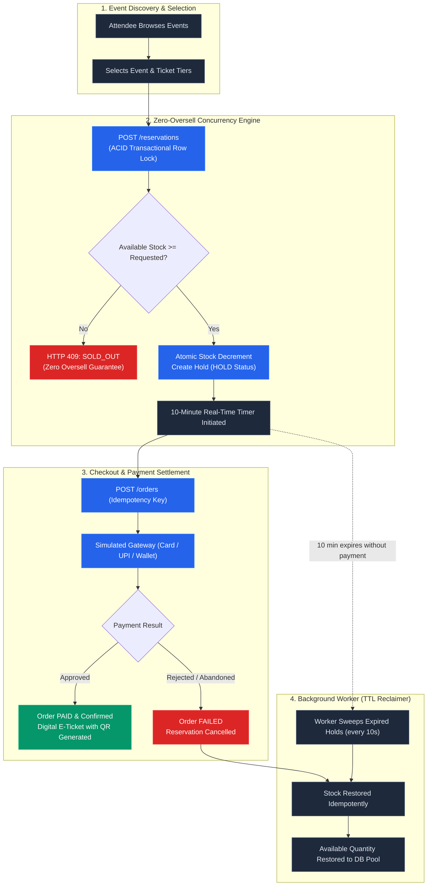
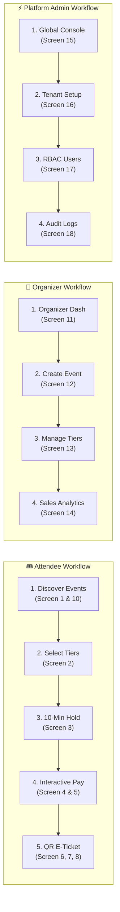
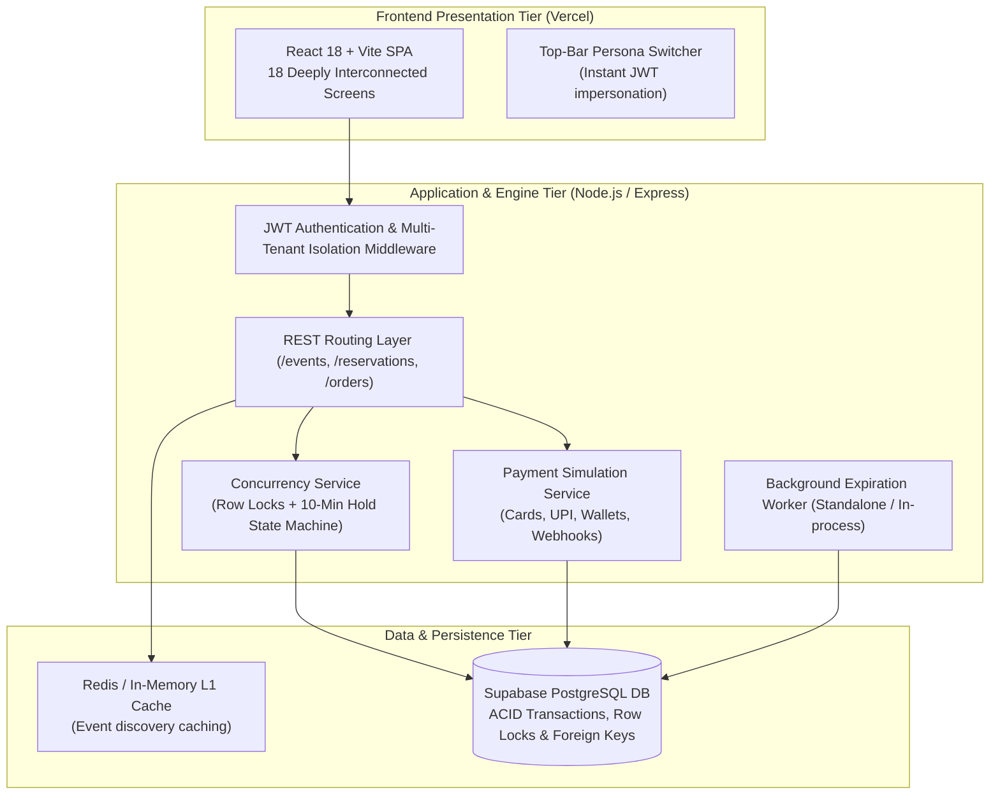

# 🎟️ EventHub • EventForge
### Enterprise Multi-Tenant Event Discovery & Concurrency-Safe Ticket Reservation Platform

[](https://frontend-tfcd.vercel.app/)
[](https://www.typescriptlang.org/)
[](https://react.dev/)
[](https://nodejs.org/)
[](https://expressjs.com/)
[](https://www.postgresql.org/)
[](https://www.docker.com/)
[](docs/TEST_PLAN.md)

---

> ### 🌐 **Live Production Deployment**
> 👉 **Explore the full application live in your browser:**  
> **[https://frontend-tfcd.vercel.app/](https://frontend-tfcd.vercel.app/)**  
> *(No setup required — use the instant top-bar Role Switcher to toggle between Attendee, Organizer, and Admin personas)*

---

## 🌟 Executive Summary

**EventForge (EventHub)** is an enterprise-grade, multi-tenant ticketing platform engineered specifically to eliminate **race conditions, inventory overselling, and ghost bookings** during high-demand flash sales. 

Built strictly according to real-world event specifications, it pairs a **transactional row-locking concurrency engine** with an automated **10-minute temporary inventory hold system**, an automated background expiration worker, simulated multi-method payment settlement, and **18 fully-featured interactive screens** across three distinct tenant roles.

---

## 🧭 System Workflows & Core Architecture

### 1. ⚡ Concurrency-Safe Reservation & Expiry Lifecycle

When multiple attendees simultaneously compete for limited tickets (e.g., flash sales), EventHub enforces transactional ACID isolation:



---

### 2. 🎭 Multi-Persona User Journeys

The platform provides dedicated, isolated interfaces and workflows for each stakeholder:



---

### 3. 🏗️ High-Level Architectural Topology



---

## 👥 Instant Test Accounts & Demo Credentials

Use the **1-Click Role Switcher** at the top of the app to change roles on the fly, or log in manually with the seeded credentials below:

| Persona | Test Email | Password | Tenant / Organization Scope | Key Capabilities |
|:---|:---|:---|:---|:---|
| **Attendee** | `blessed@example.com` | `password123` | SaiRam Tech Club | Search events, reserve tickets with 10-min hold, mock payment, view digital E-Tickets with QR code |
| **Organizer** | `priya@example.com` | `password123` | SaiRam Tech Club | Create events, manage ticket tiers & pricing, view attendee bookings, track sales & revenue charts |
| **Organizer (Tenant 2)** | `arun@example.com` | `password123` | Chennai Events | Isolated secondary tenant; demonstrates strict cross-tenant data privacy and security |
| **Platform Admin** | `admin@example.com` | `admin123` | Global Scope | Multi-tenant onboarding, tenant suspension, global user management, real-time structured system audit logs |

---

## 📱 The 18 Complete Screens Reference

EventHub features **18 distinct, interconnected screens** delivering a complete, frictionless event management experience:

| # | Screen Name | Target Persona | Architectural Highlights |
|:---:|:---|:---:|:---|
| **01** | **Landing Page** | Public | Featured hero banners, live search, city filter pills, categorized event carousels |
| **02** | **Event Details** | Attendee | Multi-tab view (About, Tickets, Venue, FAQ), dynamic ticket tier picker, live remaining stock counters |
| **03** | **Reservation Hold** | Attendee | Concurrency lock screen with 10-minute animated countdown timer and order breakdown |
| **04** | **Checkout & Payment** | Attendee | Multi-method checkout: Credit/Debit Cards, Simulated UPI (GPay/PhonePe), Digital Wallets |
| **05** | **Payment Processing** | Attendee | Real-time multi-step simulation animation (Validating ➔ Handshake ➔ Settling ➔ Approving) |
| **06** | **Booking Confirmation** | Attendee | Interactive confetti celebration, order summary, booking reference, and direct link to E-Ticket |
| **07** | **My Bookings** | Attendee | Tabbed view of active, upcoming, and past event tickets with quick download & cancel actions |
| **08** | **Digital E-Ticket** | Attendee | High-resolution boarding-pass style ticket with generated QR code, attendee details, and tear-off stub |
| **09** | **Profile & Settings** | All Users | Account details, organization affiliation, role badge, password updates, and session management |
| **10** | **Browse & Search** | Public | Search query engine, city filters (Chennai, Bangalore, Mumbai), category filters, and card grid |
| **11** | **Organizer Dashboard** | Organizer | Key metric cards (Total Revenue, Tickets Sold, Active Events), recent attendee orders table |
| **12** | **Create Event** | Organizer | Complete event publishing form with banner preview, date/time pickers, category, and venue details |
| **13** | **Manage Ticket Tiers**| Organizer | Add/delete ticket tiers, set prices, define max capacity, and monitor remaining vs. sold counts |
| **14** | **Financial Analytics**| Organizer | Revenue trends, sales breakdown per tier, occupancy percentages, and financial summary charts |
| **15** | **Platform Admin** | Admin | Global overview: multi-tenant counts, total platform users, system uptime, aggregate revenue |
| **16** | **Manage Tenants** | Admin | Onboard new event organizations, assign custom slugs, and view tenant health metrics |
| **17** | **Manage Users** | Admin | Complete user directory, role assignment (`admin`, `organizer`, `attendee`), and account status controls |
| **18** | **System Audit Logs** | Admin | Live structured audit trail capturing all system events (reservations, cancellations, logins, errors) |

---

## 🧪 Concurrency Race-Condition Verification

To mathematically prove that ticket inventory cannot be oversold under intense load, an automated concurrency test suite is built directly into the backend:

```bash
cd backend
npm run test:concurrency
```

### Verified Test Matrix:

| Test ID | Critical Scenario | Procedure | Outcome | Concurrency Status |
|:---:|:---|:---|:---|:---:|
| **TC-01** | Single ticket hold | 1 attendee reserves 1 ticket when available = 1 | Hold granted, remaining stock = 0 | ✅ **PASSED** |
| **TC-02** | **10-Way Simultaneous Race** | **10 concurrent requests compete for 1 ticket** | **Exactly 1 succeeds, 9 receive `SOLD_OUT`** | ✅ **PASSED** |
| **TC-03** | Stock over-request | Attendee requests 5 tickets when available = 0 | HTTP 409 `SOLD_OUT`, zero allocation | ✅ **PASSED** |
| **TC-04** | Expired hold checkout | Attempt to pay after 10-minute timer expiry | HTTP 409 `RESERVATION_EXPIRED` | ✅ **PASSED** |
| **TC-05** | Idempotent order retries| Repeat checkout with duplicate `Idempotency-Key` | Identical order returned without double billing | ✅ **PASSED** |
| **TC-06** | Worker re-sweep idempotency| Run worker twice on an already restored reservation | Inventory restored exactly once | ✅ **PASSED** |
| **TC-07** | Payment approved flow | Complete mock payment with approval | Order `PAID`, reservation `CONFIRMED` | ✅ **PASSED** |
| **TC-08** | Payment rejected flow | Complete mock payment with rejection | Order `FAILED`, reservation restored to stock | ✅ **PASSED** |
| **TC-09** | Cross-attendee isolation| Attendee A attempts to view/cancel Attendee B's hold | HTTP 403 `FORBIDDEN` | ✅ **PASSED** |
| **TC-10** | Multi-tenant isolation | Organizer A attempts to alter Organizer B's events | HTTP 403 `FORBIDDEN` | ✅ **PASSED** |

### 📮 Postman Collection & Automated Edge-Case Test Suite

The repository includes a ready-to-import Postman collection located at [`backend/postman/eventforge.postman_collection.json`](backend/postman/eventforge.postman_collection.json) featuring **17 automated test requests** organized into 7 folders:
- **1. Authentication & RBAC**: Login for Attendee, Organizer, and Platform Admin with automated JWT variable capture.
- **2. Event Discovery & Redis Caching**: Heavy-read event browsing cached in Redis with pattern-based invalidation.
- **3. Reservation Engine (10-Min Hold)**: Atomic PostgreSQL `SELECT FOR UPDATE` hold creation with TTL expiration assertions.
- **4. Orders & Idempotency**: Creation and deduplicated retry verification via client `Idempotency-Key`.
- **5. Payment Simulation**: Synchronous payment approval, asynchronous simulation (`HTTP 202`), and signed webhook callbacks.
- **6. Edge Cases & Concurrency Tests**:
  - `Edge Case 1: Sold Out / Zero Overselling (HTTP 409 SOLD_OUT)`
  - `Edge Case 2: Checkout on Expired Reservation Hold (HTTP 409 RESERVATION_EXPIRED)`
  - `Edge Case 3: Invalid Quantity Zero / Negative (HTTP 400 VALIDATION_ERROR)`
  - `Edge Case 4: Cross-Tenant Isolation (HTTP 403 FORBIDDEN)`
- **7. Analytics & Admin**: Real-time revenue/conversion dashboard metrics and structured audit logging.

**Run via Newman CLI:**
```bash
npx newman run backend/postman/eventforge.postman_collection.json --env-var baseUrl=http://localhost:4000
```

---

## 📂 Repository Directory Structure

```
EventHub/
├── frontend/                          # Client Tier (Vercel SPA)
│   ├── src/
│   │   ├── api.ts                     # Fully typed REST API client with auto-JWT & role switcher
│   │   ├── App.tsx                    # Primary application component covering all 18 screens
│   │   ├── styles.css                 # Custom glassmorphic design system with vibrant accents
│   │   └── main.tsx                   # React root entrypoint
│   ├── public/images/                 # High-resolution generated event banner assets
│   ├── vercel.json                    # SPA routing rewrite configuration for Vercel
│   └── package.json
│
├── backend/                           # Engine & Service Tier
│   ├── src/
│   │   ├── app.ts                     # Express application configuration & security middleware
│   │   ├── server.ts                  # HTTP API server entrypoint (port 4000)
│   │   ├── routes.ts                  # REST API controllers & endpoint definitions
│   │   ├── worker.ts                  # Background TTL hold expiration worker daemon
│   │   ├── config.ts                  # Environment configuration & fallbacks
│   │   ├── db/
│   │   │   ├── index.ts               # Transactional ACID DB client with row-locking logic
│   │   │   └── seed.ts                # Seed data (tenants, users, events, ticket tiers)
│   │   ├── middleware/
│   │   │   └── auth.ts                # JWT authentication, role verification & tenant isolation
│   │   ├── lib/
│   │   │   ├── cache.ts               # Redis & in-memory caching engine
│   │   │   └── logger.ts              # Structured JSON audit logger (Screen 18)
│   │   ├── services/
│   │   │   ├── reservationService.ts  # Concurrency hold state machine
│   │   │   ├── orderService.ts        # Idempotent order snapshot generator
│   │   │   ├── paymentService.ts      # Multi-method mock payment processor
│   │   │   └── analyticsService.ts    # Multi-tenant financial analytics aggregator
│   │   └── test/
│   │       └── concurrencyTest.ts     # Automated race-condition test runner
│   ├── supabase/
│   │   └── migrations/
│   │       └── 001_initial.sql        # Supabase PostgreSQL schema migration
│   ├── postman/
│   │   └── eventforge.postman_collection.json # Exported Postman API test collection
│   └── package.json
│
├── docs/                              # Technical Specifications & Documentation
│   ├── ER_DIAGRAM.md                  # Relational schema ER diagram & data dictionary
│   ├── TEST_PLAN.md                   # Complete acceptance test plan & criteria
│   └── DEPLOYMENT_GUIDE.md            # Step-by-step production deployment instructions
│
├── docker-compose.yml                 # Local containerized PostgreSQL & Redis orchestration
├── render.yaml                        # Infrastructure-as-Code for Render Cloud deployment
└── README.md
```

---

## ⚡ Quick Start (Local Development)

### Prerequisites
- **Node.js**: v20 or higher
- **npm**: v10 or higher
- *(Optional)* **Docker Desktop**: If using containerized PostgreSQL/Redis

---

### Step 1: Clone Repository
```bash
git clone https://github.com/BLESSEDSAMUELES/EventHub.git
cd EventHub
```

### Step 2: Start Backend Service
```bash
cd backend
npm install
npm run dev
```
- API Server running at: **`http://localhost:4000`**
- Health Check endpoint: **`http://localhost:4000/health`**
- *(The background expiration worker runs automatically inside development mode)*

### Step 3: Start Frontend SPA
In a separate terminal:
```bash
cd frontend
npm install
npm run dev
```
- Client application running at: **`http://localhost:5173`**

---

### Step 4: Run with Docker Compose (Optional)
To spin up a local PostgreSQL database and Redis cache instance:
```bash
docker-compose up -d
```

---

## 🔌 Core API Endpoints

| Method | Endpoint | Access | Description |
|:---|:---|:---:|:---|
| `POST` | `/api/auth/register` | Public | Register new attendee or organizer |
| `POST` | `/api/auth/login` | Public | Authenticate and obtain JWT access token |
| `GET` | `/api/events` | Public | Discover events with query, city, and category filters |
| `GET` | `/api/events/:id` | Public | Fetch event details with live ticket tiers and stock |
| `POST` | `/api/reservations` | Attendee | **Atomic reservation hold** (locks stock for 10 minutes) |
| `GET` | `/api/reservations/:id` | Attendee | Fetch reservation details and countdown timer |
| `POST` | `/api/reservations/:id/cancel` | Attendee | Release reservation hold and return tickets to pool |
| `POST` | `/api/orders` | Attendee | Create idempotent order from active reservation |
| `POST` | `/api/payments/mock` | Attendee | Simulate mock payment (card, UPI, wallet) |
| `GET` | `/api/orders/my-orders` | Attendee | List confirmed tickets and bookings |
| `POST` | `/api/organizer/events` | Organizer | Create and publish a new event |
| `POST` | `/api/organizer/events/:id/tiers`| Organizer | Create and price a new ticket tier |
| `GET` | `/api/organizer/analytics` | Organizer | Fetch tenant-scoped revenue and sales statistics |
| `GET` | `/api/admin/tenants` | Admin | List all tenant organizations and event tallies |
| `GET` | `/api/admin/logs` | Admin | Query structured system audit logs |

---

## 🚀 Production Deployment Reference

| Component | Platform | Configuration File |
|:---|:---|:---|
| **Frontend SPA** | [Vercel](https://frontend-tfcd.vercel.app/) | [`frontend/vercel.json`](frontend/vercel.json) |
| **Backend API** | Render / Railway / Docker | [`render.yaml`](render.yaml) & [`backend/Dockerfile`](backend/Dockerfile) |
| **Database** | Supabase (PostgreSQL 15) | [`backend/supabase/migrations/001_initial.sql`](backend/supabase/migrations/001_initial.sql) |

📖 **For detailed deployment procedures, environment variable keys, and cloud provisioning guides, refer to the [Production Deployment Guide](docs/DEPLOYMENT_GUIDE.md).**

---

## 📄 License & Credits

Developed with ❤️ by **Blessed Samuel** as part of the Enterprise Event Management Project.  
Licensed under the [MIT License](LICENSE).
