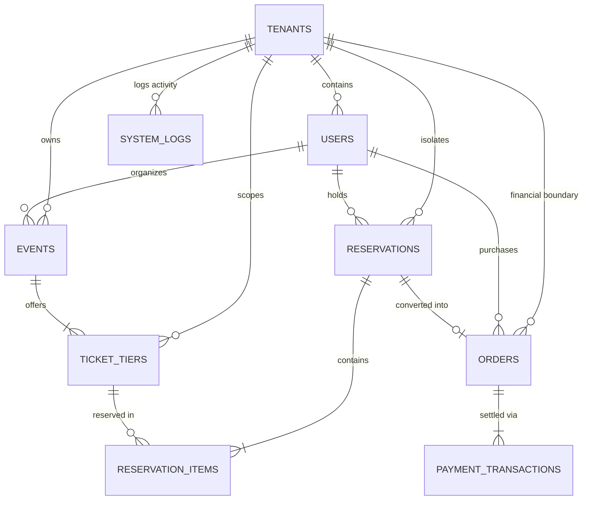

# EventForge - Database Entity Relationship (ER) Model

This document specifies the relational schema, constraints, cardinality, and data dictionary for EventForge.

## 1. Mermaid Entity-Relationship Diagram

---

## 2. Relational Schema Data Dictionary

### 2.1 Table: `tenants`
| Column | Type | Constraints | Description |
|---|---|---|---|
| `id` | UUID | PRIMARY KEY, DEFAULT gen_random_uuid() | Unique tenant identifier |
| `name` | VARCHAR(255) | NOT NULL | Organizer company or institution name |
| `slug` | VARCHAR(100) | NOT NULL, UNIQUE | URL-safe unique subpath or identifier |
| `contact_email` | VARCHAR(255) | NULLABLE | Primary operational point of contact |
| `status` | VARCHAR(50) | NOT NULL, DEFAULT 'active' | Tenant state: `active`, `suspended`, `inactive` |
| `created_at` | TIMESTAMPTZ | NOT NULL, DEFAULT NOW() | Record creation timestamp |

### 2.2 Table: `users`
| Column | Type | Constraints | Description |
|---|---|---|---|
| `id` | UUID | PRIMARY KEY, DEFAULT gen_random_uuid() | Unique user identifier |
| `tenant_id` | UUID | FK -> `tenants(id)` ON DELETE SET NULL | Tenant membership (NULL for Platform Admin) |
| `email` | VARCHAR(255) | NOT NULL, UNIQUE | User login email |
| `full_name` | VARCHAR(255) | NOT NULL | Full user display name |
| `phone` | VARCHAR(50) | NULLABLE | Contact phone number |
| `password_hash`| VARCHAR(255) | NOT NULL | Bcrypt hashed credential |
| `role` | VARCHAR(50) | NOT NULL, CHECK (role IN ('admin', 'organizer', 'attendee')) | User role |
| `status` | VARCHAR(50) | NOT NULL, DEFAULT 'active' | Account state |
| `created_at` | TIMESTAMPTZ | NOT NULL, DEFAULT NOW() | Registration timestamp |

### 2.3 Table: `events`
| Column | Type | Constraints | Description |
|---|---|---|---|
| `id` | UUID | PRIMARY KEY, DEFAULT gen_random_uuid() | Unique event identifier |
| `tenant_id` | UUID | FK -> `tenants(id)` ON DELETE CASCADE | Scoped tenant owner |
| `organizer_id` | UUID | FK -> `users(id)` ON DELETE CASCADE | Creating organizer user |
| `title` | VARCHAR(255) | NOT NULL | Event title |
| `category` | VARCHAR(100) | NOT NULL, DEFAULT 'Tech' | Category (Tech, Music, Food, Workshop) |
| `description` | TEXT | NULLABLE | Full event description |
| `venue` | VARCHAR(255) | NOT NULL | Venue name and address |
| `city` | VARCHAR(100) | NOT NULL, DEFAULT 'Chennai' | Location city |
| `starts_at` | TIMESTAMPTZ | NOT NULL | Event start date and time |
| `ends_at` | TIMESTAMPTZ | NOT NULL | Event end date and time |
| `sales_cutoff` | TIMESTAMPTZ | NOT NULL | Cut-off time for ticket purchases |
| `status` | VARCHAR(50) | NOT NULL, DEFAULT 'published' | Status (`draft`, `published`, `cancelled`) |
| `image_url` | VARCHAR(500) | NULLABLE | Promotional cover image URL |
| `created_at` | TIMESTAMPTZ | NOT NULL, DEFAULT NOW() | Creation timestamp |

### 2.4 Table: `ticket_tiers`
| Column | Type | Constraints | Description |
|---|---|---|---|
| `id` | UUID | PRIMARY KEY, DEFAULT gen_random_uuid() | Unique tier identifier |
| `tenant_id` | UUID | FK -> `tenants(id)` ON DELETE CASCADE | Scoped tenant owner |
| `event_id` | UUID | FK -> `events(id)` ON DELETE CASCADE | Associated event |
| `name` | VARCHAR(100) | NOT NULL | Tier title (e.g. "VIP", "General Admission") |
| `description` | VARCHAR(255) | NULLABLE | Perks or access details |
| `price_cents` | INTEGER | NOT NULL, CHECK (price_cents >= 0) | Price in minor currency units (e.g., paise) |
| `currency` | VARCHAR(10) | NOT NULL, DEFAULT 'INR' | ISO currency code |
| `total_quantity`| INTEGER | NOT NULL, CHECK (total_quantity >= 0) | Initial total capacity allocated |
| `available_quantity`| INTEGER | NOT NULL, CHECK (available_quantity >= 0 AND available_quantity <= total_quantity) | Real-time unsold inventory |
| `created_at` | TIMESTAMPTZ | NOT NULL, DEFAULT NOW() | Creation timestamp |

### 2.5 Table: `reservations`
| Column | Type | Constraints | Description |
|---|---|---|---|
| `id` | UUID | PRIMARY KEY, DEFAULT gen_random_uuid() | Unique reservation identifier |
| `tenant_id` | UUID | FK -> `tenants(id)` ON DELETE CASCADE | Scoped tenant owner |
| `attendee_id` | UUID | FK -> `users(id)` ON DELETE CASCADE | Reserving attendee |
| `status` | VARCHAR(50) | NOT NULL, DEFAULT 'ACTIVE' | State: `ACTIVE`, `CHECKOUT`, `CONFIRMED`, `EXPIRED`, `CANCELLED` |
| `expires_at` | TIMESTAMPTZ | NOT NULL | Point in time when 10-minute hold expires |
| `created_at` | TIMESTAMPTZ | NOT NULL, DEFAULT NOW() | Reservation timestamp |
| `updated_at` | TIMESTAMPTZ | NOT NULL, DEFAULT NOW() | Last state transition timestamp |

### 2.6 Table: `reservation_items`
| Column | Type | Constraints | Description |
|---|---|---|---|
| `id` | UUID | PRIMARY KEY, DEFAULT gen_random_uuid() | Line item identifier |
| `reservation_id`| UUID | FK -> `reservations(id)` ON DELETE CASCADE | Parent reservation |
| `ticket_tier_id`| UUID | FK -> `ticket_tiers(id)` ON DELETE RESTRICT | Target tier |
| `quantity` | INTEGER | NOT NULL, CHECK (quantity > 0) | Number of tickets held |
| `unit_price_cents`| INTEGER | NOT NULL, CHECK (unit_price_cents >= 0) | Snapshot price in minor currency units |

### 2.7 Table: `orders`
| Column | Type | Constraints | Description |
|---|---|---|---|
| `id` | UUID | PRIMARY KEY, DEFAULT gen_random_uuid() | Unique order identifier |
| `tenant_id` | UUID | FK -> `tenants(id)` ON DELETE CASCADE | Scoped tenant owner |
| `reservation_id`| UUID | UNIQUE, FK -> `reservations(id)` ON DELETE RESTRICT | Exactly one order per reservation |
| `attendee_id` | UUID | FK -> `users(id)` ON DELETE CASCADE | Purchasing attendee |
| `total_cents` | INTEGER | NOT NULL, CHECK (total_cents >= 0) | Calculated sum snapshot |
| `status` | VARCHAR(50) | NOT NULL, DEFAULT 'PENDING' | Status: `PENDING`, `PAID`, `FAILED`, `EXPIRED`, `REFUNDED` |
| `idempotency_key`| VARCHAR(255) | NOT NULL | Client-submitted deduplication key |
| `created_at` | TIMESTAMPTZ | NOT NULL, DEFAULT NOW() | Order generation timestamp |

### 2.8 Table: `payment_transactions`
| Column | Type | Constraints | Description |
|---|---|---|---|
| `id` | UUID | PRIMARY KEY, DEFAULT gen_random_uuid() | Transaction ledger ID |
| `order_id` | UUID | FK -> `orders(id)` ON DELETE CASCADE | Target order |
| `provider_reference`| VARCHAR(255) | UNIQUE, NOT NULL | Gateway transaction reference |
| `amount_cents` | INTEGER | NOT NULL, CHECK (amount_cents >= 0) | Settled amount |
| `payment_method`| VARCHAR(50) | NOT NULL, DEFAULT 'credit_card' | Method: `credit_card`, `upi`, `wallet` |
| `status` | VARCHAR(50) | NOT NULL, CHECK (status IN ('PENDING', 'SUCCESS', 'FAILED')) | Payment outcome |
| `raw_result` | JSONB | NULLABLE | Gateway payload response |
| `created_at` | TIMESTAMPTZ | NOT NULL, DEFAULT NOW() | Execution timestamp |

### 2.9 Table: `system_logs`
| Column | Type | Constraints | Description |
|---|---|---|---|
| `id` | UUID | PRIMARY KEY, DEFAULT gen_random_uuid() | Unique audit log ID |
| `tenant_id` | UUID | FK -> `tenants(id)` NULLABLE | Scoped tenant or NULL for platform |
| `level` | VARCHAR(20) | NOT NULL, CHECK (level IN ('INFO', 'WARN', 'ERROR')) | Severity level |
| `message` | TEXT | NOT NULL | Human-readable log description |
| `metadata` | JSONB | NULLABLE | Diagnostic details |
| `created_at` | TIMESTAMPTZ | NOT NULL, DEFAULT NOW() | Log entry timestamp |
